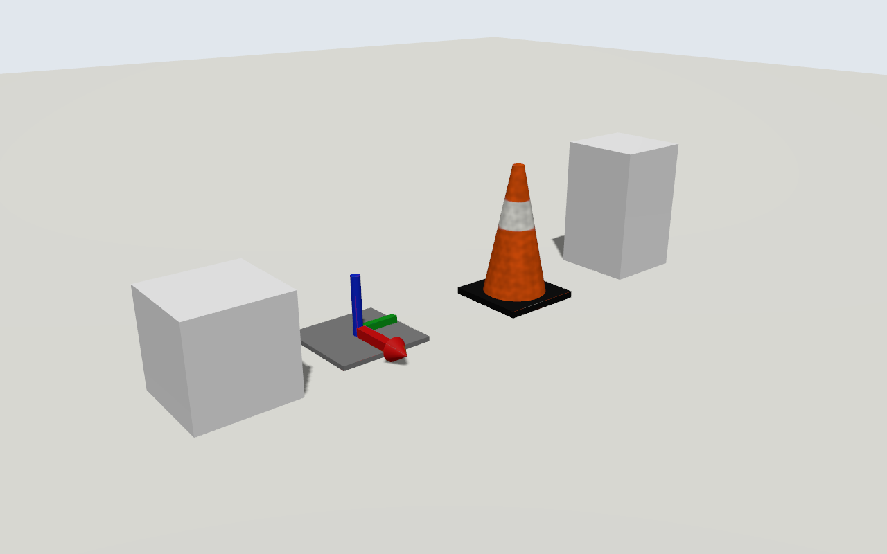
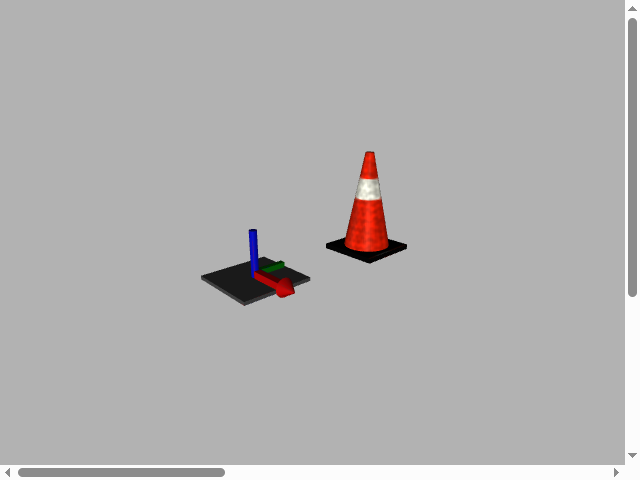

# C1 format spike: library-built GLB in Gazebo and gzweb

**Result (2026-10-17): pass.** GLB models built with the library stack (build123d, xatlas, trimesh; decision D-9, no Blender) load and render correctly in Gazebo Harmonic 8.15, gz-sim 11 (pre-release) and gzweb 3. Orientation, scale, the baked texture atlas, smooth normals and convex-hull collision all behave. D-3 (GLB) stands.

| | Gazebo Harmonic 8.15 | gzweb 3 (headless Chrome) |
|---|---|---|
| Render |  |  |

## What was checked

| Check | Gazebo Harmonic 8.15 | gz-sim 11 | gzweb 3 |
|---|---|---|---|
| GLB loads, no errors | yes | yes | yes |
| Embedded base color and packed metallic-roughness textures | yes (loader splits the MR map) | yes | yes (`map`, `roughnessMap`) |
| Orientation: red arrow +X, green +Y, blue +Z | yes ([side view](results/harmonic-side.png): arrow faces the +X camera) | yes | yes (axes model's world bounding box 0.52 × 0.40 × 0.28 m, X longest) |
| Scale matches reference boxes | yes | yes | yes (cone 0.36 × 0.36 × 0.60 m) |
| Cone's procedural band baked into the atlas (`results/cone-albedo-atlas.png`) | yes | yes | yes |
| Smooth shading on the cone, hard edges on the base | yes | yes | yes |
| Cone dropped from 0.2 m comes to rest on its base, using the convex-hull collision | z = −4×10⁻⁷ m, upright | same | n/a |

## Findings that feed C1

1. **Axis convention.** Write vertices in Gazebo's frame (Z up, +X forward) with no root-node rotation.
   - Gazebo's assimp loader keeps glTF node transforms but does no Y-up conversion (`gz-common` `AssimpLoader.cc`, `UpdatedRootNodeTransform`).
   - gzweb's GLTFLoader uses the scene as-is.
   - This is not glTF's Y-up convention, so generic glTF viewers show the models lying down. Blender's default exporter (Y-up) would have produced rotated models in both.
2. **UVs.** trimesh's `TextureVisuals` UV origin is bottom-left and it flips V on glTF export, so the atlas is rasterized with image row 0 at v = 1. This is confirmed by the band landing in the right place in all three renderers.
3. **Color space differs between renderers.** The grey 0.5 plate looks darker in gzweb than in Gazebo. three.js decodes base-color textures as sRGB; Ogre2 appears not to. Author material colors in sRGB (what people perceive), and check new materials in both renderers.
4. **Previews need another renderer.** pyrender 0.1.45 (frozen since 2021) fails under numpy 2.5 / PyOpenGL. Options are a small numpy software rasterizer (the atlas baker already has one), headless gzweb, or Gazebo headless.
5. **Install size.** The library stack installs to about 900 MB, not tens of MB:
   - OCP (OCCT) about 380 MB unpacked;
   - scipy about 120 MB;
   - transitive extras: threejs_materials 87 MB, sklearn, jedi.

   It's comparable to Blender. The case for it is licensing, an API that works as a library, and agent evidence. Trim the extras when the worker image is built.
6. **Gazebo headless capture.** Cameras render only while something subscribes to their image topic, so `<save>` writes nothing on its own. `run_gazebo.sh` keeps subscribers attached. In Docker, set `GZ_PARTITION` (and use the host network) or `gz topic` can't discover the server.
7. **DART** logs "Mesh construction from an SDF has not been implemented yet for dartsim" at debug level. That message is expected: mesh collisions go through `AttachMeshShapeFeature`, and the cone came to rest correctly.

## Running it

```sh
# 1. Export (Python 3.12 venv with build123d, trimesh, xatlas, pillow, numpy)
python export.py OUT

# 2. Gazebo: host install (gz-sim major as 2nd arg)...
./run_gazebo.sh OUT 11
# ...or Harmonic in a container (the local Harmonic install mixes in gz-rendering 11's plugin)
docker run --rm --network host -e GZ_PARTITION=spike --device nvidia.com/gpu=all \
  -e NVIDIA_DRIVER_CAPABILITIES=all --user $(id -u):$(id -g) -e HOME=/tmp \
  -v OUT:/spike -v $PWD:/scripts:ro --entrypoint bash gz-websocket:latest -lc \
  'cp /scripts/run_gazebo.sh /tmp/r.sh && sed -i "s/gz sim --force-version \"\$major\"/gz sim/; s|\$here/world.sdf|/scripts/world.sdf|" /tmp/r.sh && bash /tmp/r.sh /spike 8'
```

gzweb was checked by uploading both model folders into a project on a test fuel-server (binary `PUT`), then loading the world in headless Chrome through gzweb's `AssetViewer`, the AI Builder's `resolveProjectUris` and signed file URLs. This is the same harness as the B1 render check.
